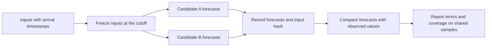

# StockLab Engineering Demo

This demo uses synthetic data to illustrate how StockLab evaluates time-series forecasts. It freezes the data available at forecast time, then measures both candidates' errors on the same set of samples once the actual values are available.



- **Point-in-time inputs.** Each input has an observation date and a timestamp for when it became available. The demo excludes inputs that arrive after the cutoff.
- **Fair comparison.** Both sets of forecasts must share the same cutoff and input hash. The demo scores only items for which both candidates made a forecast and an observed value is available.
- **Evaluation coverage.** The output reports mean absolute error (MAE) and the number of samples evaluated. Missing observations are excluded from the calculation.
- **Workflow stages.** StockLab records data collection, preparation, forecast freezing, and evaluation separately. This demo focuses on freezing inputs and calculating forecast errors.

## Run the demo

The demo requires Python 3.10 or later and uses only the standard library.

```bash
python demo.py
```

The forecasts and observed values are fixed synthetic examples. This public repository contains technical documentation and a standalone example.
