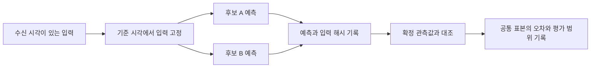

# StockLab 기술 데모

StockLab의 시계열 예측 검증 흐름을 합성 데이터로 재현합니다. 예측을 만들 때 이용할 수 있었던 데이터만 고정하고, 관측값이 공개된 뒤 두 후보의 오차를 같은 표본에서 비교합니다.



- **시점 관리** · 관측 대상 날짜와 데이터가 실제로 사용 가능해진 시각을 구분합니다. 예제는 기준 시각 이후 도착한 입력을 제외합니다.
- **공정한 비교** · 같은 입력 사본으로 계산한 예측만 비교합니다. 예측 기준 시각과 입력 해시가 일치해야 하며, 두 후보와 확정 관측값에 모두 있는 항목만 평가합니다.
- **평가 범위** · 평균 절대오차와 함께 평가 표본 수를 표시합니다. 누락된 관측값을 0으로 채우지 않습니다.
- **작업 분리** · 실제 시스템의 흐름은 수집, 준비, 예측 고정, 결과 대조를 각각 기록합니다. 이 데모는 입력 고정과 오차 계산만 재현합니다.

## 실행

Python 3.10 이상에서 표준 라이브러리로 실행합니다.

```bash
python demo.py
```

예제의 A·B 예측과 관측값은 설명을 위해 만든 고정값입니다. 출력에는 두 후보의 평균 절대오차와 공통 평가 표본 수가 표시됩니다. 이 저장소의 공개 범위는 기술 문서와 독립적인 예제 코드입니다.
